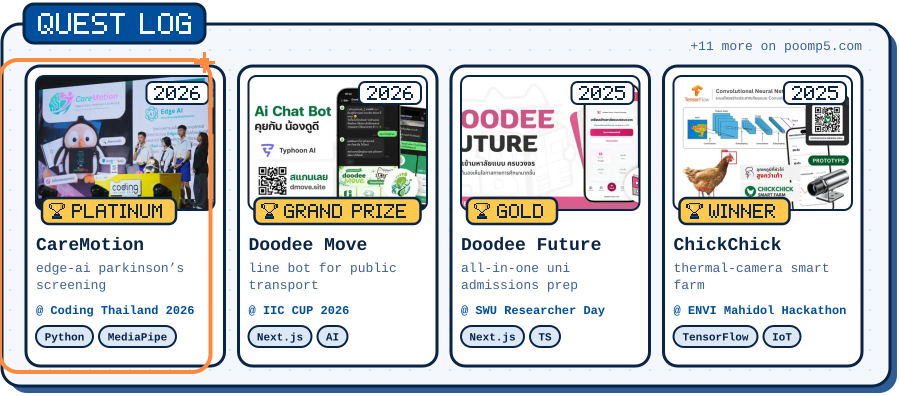
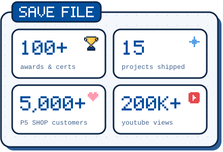

<!--
  notes for future me ~
  · all the text on the cards lives in scripts/profile.mjs → edit it, then run:  node scripts/build.mjs
  · preview everything locally:  node scripts/build.mjs preview  → open preview/index.html
  · header, status (level/xp) and the skate log are redrawn every day by
    .github/workflows/daily.yml and published to the `output` branch
  · project thumbnails are in assets/art/ (400×300 webp)
-->

   

 

